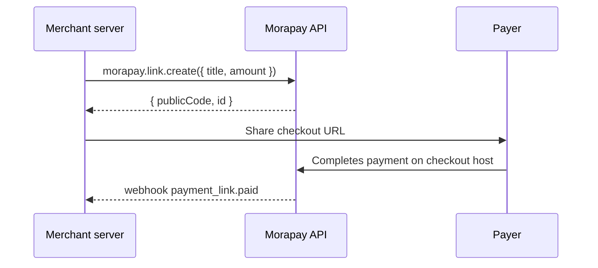

> ## Documentation Index
> Fetch the complete documentation index at: https://docs.morapay.io/llms.txt
> Use this file to discover all available pages before exploring further.

# Payment links

> Create checkout links, track payments, and issue per-customer product links.

Payment links are fixed-amount checkout URLs you share with customers. The Merchant API exposes them at `/api/v1/merchant/links` with companion product catalog routes at `/products`.

## Why payment links

* **No custom checkout code:** share a URL or embed the hybrid widget
* **Per-customer links:** attach `customerEmail` and metadata from your CRM
* **Payment tracking**. `paidAt`, `paidByWalletAddress` on the link record

## Flow



## SDK reference

Callable pattern: list/get share one signature:

```typescript theme={null}
const { data: links } = await morapay.link({ limit: 20 });
const link = await morapay.link("link_abc123");

const created = await morapay.link.create({
  title: "Consulting March",
  amount: 250,
  currency: "USD",
});

const checkoutUrl = morapay.buildCheckoutUrl(created.publicCode);
```

### Products + per-customer links

```typescript theme={null}
const product = await morapay.products.create({
  name: "Annual plan",
  price: 49,
  currency: "USD",
  type: "DIGITAL",
});

const checkout = await morapay.products.link(product.id, {
  customerEmail: "alex@example.com",
  customerExternalId: "user_123",
});

const paid = morapay.utils.isPaid(checkout); // false until payer completes
```

### Sessions and link quotes

```typescript theme={null}
const sessions = await morapay.link.sessions("link_abc123", { limit: 10 });
const quote = await morapay.link.quote("link_abc123", { invoice_major: 100 });
```

REST equivalent: `GET /api/v1/merchant/links/:id/checkout-sessions` and `POST /api/v1/merchant/links/:id/quote`.

## Platform minimums

The API enforces minimum amounts per feature kind. Mobile money corridors may have **higher regional floors** such as 1.00 GHS. Below-minimum amounts return `links.amount.below_minimum`. See [error code docs](https://docs.morapay.io/errors/codes/links-amount-below-minimum.md).

## Checkout integration

| Pattern | SDK helper |
| - | - |
| Hosted redirect | `morapay.buildCheckoutUrl(publicCode)` |
| Same-page modal | `morapay.buildPaymentLinkEmbedUrl(publicCode)` |
| Business QR | `morapay.qr.get()` → `buildBusinessPayCheckoutUrl(slug)` |

The checkout widget (`morapay-checkout.js`) uses a **hybrid architecture**: native Shadow DOM shell on your page + secure iframe canvas for card/MoMo/KYC flows.

## Webhook

When a link is paid, Morapay emits `payment_link.paid` to your configured endpoints. See [Webhooks](https://docs.morapay.io/developer-tools/webhooks.md).

## FAQ

> [accordion] What is the default minimum for payment links?
>
> Platform default is **\$1 USD equivalent** (`minPaymentLinkUsd` in platform settings). Regional MoMo floors may be higher.

> [accordion] Can I customize the vanity slug?
>
> Yes on create/update. Duplicate slugs return `links.slug.duplicate` (HTTP 409).

> [accordion] How do I know if a customer paid?
>
> Poll `morapay.link(id)` and check `paidAt`, use `morapay.utils.isPaid(link)`, or listen for `payment_link.paid` webhooks.

## Next step

[Subscriptions](https://docs.morapay.io/concepts/subscriptions.md): recurring billing on top of the same Merchant API.


This documentation is built and hosted on [Mintlify](https://mintlify.com), a developer documentation platform.