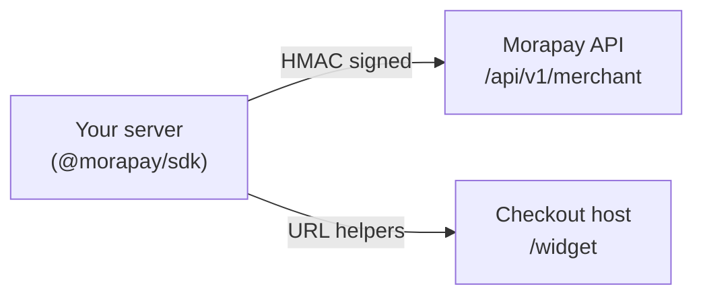

> ## Documentation Index
> Fetch the complete documentation index at: https://docs.morapay.io/llms.txt
> Use this file to discover all available pages before exploring further.

# Environments

> Morapay separates **TEST** and **LIVE** at the API key level.

## TEST vs LIVE

| | TEST | LIVE |
| - | - | - |
| Public key | `pk_test_*` | `pk_live_*` |
| Secret key | `sk_test_*` | `sk_live_*` |
| Funds | Simulated / sandbox rails | Real money movement |
| Dashboard | TEST mode toggle | LIVE mode toggle |

Use TEST keys for integration development.\
Rotate to LIVE only after checkout, webhooks, and payout flows are verified.

## API hosts

| Service | Production default | Local dev |
| - | - | - |
| **Morapay API** | `https://api.morapay.io` | |
| **Checkout** (hosted + widget) | `https://checkout.morapay.io` | `http://localhost:3002` |

SDK options:

```typescript theme={null}
const morapay = new Morapay({
  publicKey: process.env.MORAPAY_PUBLIC_KEY!,
  secretKey: process.env.MORAPAY_SECRET_KEY!,
});
```

All merchant resources live under **`/api/v1/merchant`** on the Morapay API.

## Architecture



All signing, webhooks, payment links, subscriptions, and disbursements are served from [https://api.morapay.io](https://api.morapay.io).

## Response envelope

All Morapay API JSON responses follow:

```json theme={null}
{ "success": true, "data": { ... }, "meta": { "page": 1, "limit": 20, "total": 42 } }
```

Errors include consultant fields. See [Error handling](https://docs.morapay.io/errors/error-handling.md).

## Next step

[Payment links](https://docs.morapay.io/concepts/payment-links.md): your first revenue primitive.


This documentation is built and hosted on [Mintlify](https://mintlify.com), a developer documentation platform.