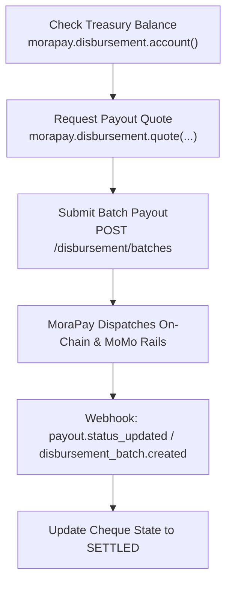

# MoraPay Integration Guide for Cheque Offramp & Onramp Service

> **Target Service:** Cheque (Digital Cheques for Ghana)  
> **Target Provider:** MoraPay ([docs.morapay.io](https://docs.morapay.io))  
> **Document Purpose:** Complete technical assessment, architecture, and integration guide for utilizing MoraPay as a primary/secondary MoMo settlement rail, account validation engine, and funding onramp.

---

## 1. Executive Summary

MoraPay is a Web3-to-fiat merchant payments and disbursement infrastructure provider specializing in African markets (Ghana, Nigeria, Kenya, South Africa, Côte d'Ivoire).

For **Cheque** (our digital cheque product for Ghana), MoraPay provides immediate solutions for our core offramp requirements:
1. **Instant Ghana MoMo Payouts:** Direct disbursements to MTN MoMo, Telecel (Vodafone) Cash, and AT (AirtelTigo) Money.
2. **Account Name Resolution:** Live lookup of registered mobile money account names before payout (`GET /rails/resolve` and `/api/public/validate/momo`), resolving payee mismatch warnings and preventing misrouted funds.
3. **Ghana Bank Payouts:** Direct clearing via GHIPSS to Ghanaian commercial banks (Absa, GCB, Ecobank, Stanbic, etc.).
4. **Sender MoMo Funding (Onramp):** Direct STK push to the sender's phone to fund cheques in GHS.
5. **Robust Developer Experience:** Modern TypeScript SDK (`@morapay/sdk`), HMAC request signing, idempotency keys, consultant-grade typed errors (`code`, `safeMessage`, `why`, `howToFix`), and outbound webhooks.

### Key Architectural Consideration: Chain Difference
* **Cheque Core:** Runs on **Stellar / Soroban** (USDC escrow).
* **MoraPay Treasury Rails:** Settles disbursements from a pooled merchant treasury balance funded with **USDC on Base (Chain ID 8453)** or **Ethereum (Chain ID 1)** (and **Base Sepolia 84532** in TEST).
* **Integration Strategy:** We use an **Adapter Pattern (`MoraPayAdapter`)** where the Cheque platform maintains a pre-funded liquidity float in MoraPay's Base USDC treasury. When a recipient claims a cheque, our backend triggers the MoraPay MoMo disbursement, and our internal ledger / rebalancer replenishes the MoraPay treasury from Stellar escrow.

---

## 2. MoraPay Feature Matrix & Ghana Coverage

| Capability | MoraPay Support | Cheque Application |
|---|---|---|
| **Ghana Mobile Money** | **Yes** (MTN, Telecel, AirtelTigo) | Primary offramp for cheque recipients |
| **Ghana Bank Transfer** | **Yes** (GHIPSS network, 20+ banks) | Secondary offramp (Phase 2 bank claims) |
| **MoMo Name Resolution** | **Yes** (`/rails/resolve` & `/api/public/validate/momo`) | Name verification on recipient claim screen |
| **MoMo Collection / Onramp** | **Yes** (Merchant Ramp / Checkout Links) | Senders fund cheques with MoMo STK push |
| **Disbursement Settlement Asset**| **USDC (Base chain 8453, Eth chain 1)** | Funded into MoraPay Treasury Account |
| **Test Environment** | **Base Sepolia (84532)** | Sandbox end-to-end testing without real money |
| **Minimum Payout** | **$5.00 USD** (carrier floor **1.00 GHS**) | Compatible with Cheque min amount (5.00 GHS) |
| **Typical Settlement Time** | MoMo: **1–5 minutes**; Bank: **Same day / 1 business day** | Fast recipient payout experience |
| **Fee Structure** | Quote-first: Payout principal + fixed batch fee + network fee | Transparent quoting before settling |

---

## 3. Core MoraPay APIs for Cheque

### 3.1 Payout Rails & Account Name Resolution
Before sending funds, Cheque requires verifying the recipient's MoMo number and comparing the registered account name to the payee's name (see `cheque.md` Section 5.3).

* **Private Signed Endpoint:** `GET /api/v1/merchant/rails/resolve`
* **Public Unsigned Endpoint:** `POST /api/public/validate/momo`

#### MoMo Account Name Lookup (Private)
```bash
curl -s "https://api.morapay.io/api/v1/merchant/rails/resolve?type=MOBILE_MONEY&phone=233241234567&provider_hint=MTN" \
  -H "Morapay-Key: $MORAPAY_PUBLIC_KEY" \
  -H "Morapay-Timestamp: $TIMESTAMP" \
  -H "Morapay-Signature: v1=$SIGNATURE"
```

Response:
```json
{
  "success": true,
  "data": {
    "accountName": "KOJO MENSAH"
  }
}
```

*If account cannot be resolved:*
```json
{
  "success": false,
  "error": "Account name could not be resolved.",
  "code": "payouts.momo.account_not_found",
  "requestId": "req_resolve422"
}
```

#### Public MoMo Validator (Can be called directly from Claim Frontend)
```bash
curl -s -X POST "https://api.morapay.io/api/public/validate/momo" \
  -H "Content-Type: application/json" \
  -d '{
    "receiver": "233241234567",
    "provider": "MTN",
    "currency": "GHS"
  }'
```

---

### 3.2 Disbursements API (Offramp Payouts)
Batch and single payouts are initiated via `/api/v1/merchant/disbursement/*` or the SDK `morapay.disbursement`.

#### Flow


#### Step 1: Check Treasury Float
```typescript
const account = await morapay.disbursement.account();
// { environment: "LIVE", balanceUsd: 1500.00, reservedUsd: 50.00, availableUsd: 1450.00 }
if (account.availableUsd < requiredUsd) {
  // Alert ops or trigger treasury rebalance
}
```

#### Step 2: Quote Batch Payout
```typescript
const quote = await morapay.disbursement.quote({
  chainId: 8453,        // Base Mainnet (or 84532 for Base Sepolia in TEST)
  token: "USDC",
  payoutTotal: 35.50,    // USD equivalent of GHS amount
  recipientCount: 1,
});
// quote.quote.usdCharge contains the exact amount debited from treasury
```

#### Step 3: Create Disbursement Batch
```typescript
const batch = await morapay.disbursement.createBatch({
  chainId: 8453,
  token: "USDC",
  schedule: "one_time",
  usdCharge: quote.quote.usdCharge,
  payoutTotal: 35.50,
  payoutDate: new Date().toISOString().split("T")[0],
  processingAt: new Date().toISOString(), // Immediate dispatch
  recipients: [
    {
      customerName: "Kojo Mensah",
      contact: "233241234567",
      payerAccount: "233241234567", // Recipient MoMo number
      amountRaw: "500",             // 500 GHS
      amountValue: 35.50,           // USD equivalent based on locked quote
      amountIsPercent: false,
    },
  ],
});
```

---

### 3.3 Sender Onramp (Funding Cheques with MoMo)
MoraPay provides two mechanisms for senders to fund cheques in GHS:

1. **Merchant Ramp API (`POST /api/v1/merchant/ramp/onramp`):**
   - Directly triggers a Mobile Money prompt (STK Push) on the sender's phone.
   - Parameters: `currency: "ghs"`, `amount: "505"`, `paymentMethod: "mobile_money"`, `phoneNumber: "0244000000"`, `networkProvider: "MTN"`.
   - Sender enters MoMo PIN on their handset; funds land in our merchant clearing account.
2. **Hosted Payment Links (`morapay.link.create`):**
   - Returns a checkout URL (`morapay.buildCheckoutUrl(link.publicCode)`) where sender selects MoMo, card, or bank.

---

### 3.4 Webhooks & Event Processing
MoraPay posts real-time event notifications with HMAC-SHA256 signature in the `Morapay-Signature` header.

#### Relevant Events
* `payout.status_updated`: Payout transitions (`PENDING` → `PROCESSING` → `COMPLETED` / `FAILED`).
* `disbursement_batch.created`: Batch received and scheduled.
* `ramp.created` / `ramp.status_updated`: Onramp/offramp transaction lifecycle.

#### Signature Verification (Node.js / TypeScript)
```typescript
import { MorapayUtils } from "@morapay/sdk";

export async function handleMorapayWebhook(rawBody: string, signature: string) {
  const isValid = MorapayUtils.verifyWebhook({
    payload: rawBody,   // MUST be raw string, not JSON.parse()
    signature: signature,
    secret: process.env.MORAPAY_WEBHOOK_SECRET!,
  });

  if (!isValid) {
    throw new Error("Invalid MoraPay webhook signature");
  }

  const event = JSON.parse(rawBody);
  switch (event.type) {
    case "payout.status_updated":
      await handlePayoutStatusUpdate(event.data);
      break;
    case "ramp.status_updated":
      await handleRampStatusUpdate(event.data);
      break;
  }
}
```

---

## 4. Comparison: MoraPay vs. SeevCash

| Feature | SeevCash | MoraPay | Winner / Assessment for Cheque |
|---|---|---|---|
| **Ecosystem & Asset** | Native Stellar Anchor (USDC on Stellar) | Multi-chain (Base & Ethereum USDC) | **SeevCash** fits Stellar natively; **MoraPay** requires Base treasury float. |
| **Integration Protocol** | Stellar SEPs (SEP-6, 10, 12, 24, 38) | Modern REST API + TypeScript SDK | **MoraPay** is significantly simpler to build and debug than SEP-10/SEP-6. |
| **Recipient Name Lookup** | Not supported programmatically | **Supported** (`/rails/resolve`) | **MoraPay** wins; solves payee name mismatch fraud check. |
| **Bank Payout in Ghana** | "Coming soon" (unsupported in prod) | **Live & Supported** (GHIPSS network) | **MoraPay** wins; enables Phase 2 bank claims today. |
| **MoMo Carriers (Ghana)** | MTN, Telecel, AirtelTigo | MTN, Telecel, AirtelTigo | **Tie** (both support all 3 networks). |
| **Error Messages & DX** | Raw SEP errors / text responses | Consultant-grade errors (`safeMessage`, `why`, `howToFix`) | **MoraPay** is superior for UX error handling. |
| **Custody / Float Model** | On-demand classic Stellar transfers | Pre-funded treasury account (Base USDC) | **SeevCash** has less capital locked; **MoraPay** requires treasury buffer. |

---

## 5. Implementation Architecture for Cheque

### 5.1 Settlement Adapter Interface
In accordance with `cheque.md` (Section 6.5), we implement `MoraPayAdapter`:

```typescript
// packages/chain/src/adapters/morapay-adapter.ts

import { Morapay } from "@morapay/sdk";
import type { 
  SettlementAdapter, 
  ChequeRecord, 
  Quote, 
  PayoutRef, 
  PayoutStatus 
} from "../types";

export class MoraPayAdapter implements SettlementAdapter {
  private client: Morapay;

  constructor(publicKey: string, secretKey: string) {
    this.client = new Morapay({ publicKey, secretKey });
  }

  async resolveAccountName(phone: string, provider: "MTN" | "VOD" | "ATL"): Promise<string | null> {
    try {
      const res = await this.client.get(`/rails/resolve`, {
        params: { type: "MOBILE_MONEY", phone, provider_hint: provider }
      });
      return res.data?.accountName ?? null;
    } catch (err) {
      return null;
    }
  }

  async quote(cheque: ChequeRecord): Promise<Quote> {
    const usdAmount = cheque.face_amount_minor / 100 / cheque.fx_rate;
    const res = await this.client.disbursement.quote({
      chainId: process.env.NODE_ENV === "production" ? 8453 : 84532,
      token: "USDC",
      payoutTotal: usdAmount,
      recipientCount: 1,
    });

    return {
      quoteId: `mora_${Date.now()}`,
      usdCharge: res.quote.usdCharge,
      payoutTotal: res.quote.payoutTotal,
      expiresAt: new Date(Date.now() + 15 * 60 * 1000),
    };
  }

  async settle(cheque: ChequeRecord, destination: { phone: string; network: string }, idempotencyKey: string): Promise<PayoutRef> {
    const batch = await this.client.disbursement.createBatch({
      chainId: process.env.NODE_ENV === "production" ? 8453 : 84532,
      token: "USDC",
      schedule: "one_time",
      usdCharge: cheque.usd_charge,
      payoutTotal: cheque.face_amount_minor / 100 / cheque.fx_rate,
      payoutDate: new Date().toISOString().split("T")[0],
      processingAt: new Date().toISOString(),
      recipients: [
        {
          customerName: cheque.payee_name,
          contact: destination.phone,
          payerAccount: destination.phone,
          amountRaw: (cheque.face_amount_minor / 100).toString(),
          amountValue: cheque.face_amount_minor / 100 / cheque.fx_rate,
          amountIsPercent: false,
        },
      ],
    });

    return {
      provider: "morapay",
      batchId: batch.id,
      status: "PENDING",
      createdAt: new Date(),
    };
  }

  async status(payoutRef: PayoutRef): Promise<PayoutStatus> {
    const batch = await this.client.disbursement(payoutRef.batchId);
    if (batch.status === "COMPLETED") return "SUCCESS";
    if (batch.status === "FAILED") return "FAILED";
    return "PENDING";
  }
}
```

### 5.2 Treasury Float Management
Because Cheque escrows USDC on Stellar while MoraPay pays out from Base USDC:
1. **Float Pool:** We deposit a float (e.g. $1,000–$5,000 USDC) into our MoraPay treasury account on Base.
2. **Reconciliation Worker:** When cheques settle on MoraPay, the corresponding Stellar USDC locked in the escrow contract is released to Cheque's operational treasury.
3. **Threshold Rebalancer:** When MoraPay `availableUsd` falls below $500, an automated alert/bridge transaction transfers USDC from Stellar to Base (via Circle CCTP or exchange).

---

## 6. Implementation Checklist & Next Steps

- [ ] **Step 1: Sign up for MoraPay Merchant Account**
  - Obtain `pk_test_*` and `sk_test_*` API keys in the developer dashboard.
  - Complete owner KYC/KYB for Ghana corridor activation.
- [ ] **Step 2: Add `@morapay/sdk` to `packages/core` or `api`**
  ```bash
  pnpm --filter @cheque/api add @morapay/sdk
  ```
- [ ] **Step 3: Implement Recipient Name Resolve in Claim Flow**
  - Connect the claim frontend to MoraPay `/rails/resolve` to show registered account holder name.
- [ ] **Step 4: Configure Webhook Endpoint**
  - Deploy `/api/webhooks/morapay` and register the URL in the MoraPay dashboard.
  - Listen for `payout.status_updated` to mark cheques `SETTLED`.
- [ ] **Step 5: Fund Base Sepolia Treasury for Sandbox Testing**
  - Request testnet USDC on Base Sepolia (`84532`) to test end-to-end disbursement.
- [ ] **Step 6: Fallback & Multi-Rail Routing**
  - Configure MoraPay as primary payout provider, with SeevCash or direct Stellar USDC as fallback if carrier downtime (`payouts.network.carrier_down`) is reported.

---

## 7. Useful Resources & Links

* **Official Docs:** [docs.morapay.io](https://docs.morapay.io)
* **Quickstart:** [docs.morapay.io/getting-started/quickstart](https://docs.morapay.io/getting-started/quickstart)
* **Disbursement API:** [docs.morapay.io/api-reference/disbursement](https://docs.morapay.io/api-reference/disbursement)
* **Payout Rails & Resolve:** [docs.morapay.io/api-reference/payout-rails](https://docs.morapay.io/api-reference/payout-rails)
* **Merchant Ramp:** [docs.morapay.io/api-reference/merchant-ramp](https://docs.morapay.io/api-reference/merchant-ramp)
* **Webhooks:** [docs.morapay.io/developer-tools/webhooks](https://docs.morapay.io/developer-tools/webhooks)
